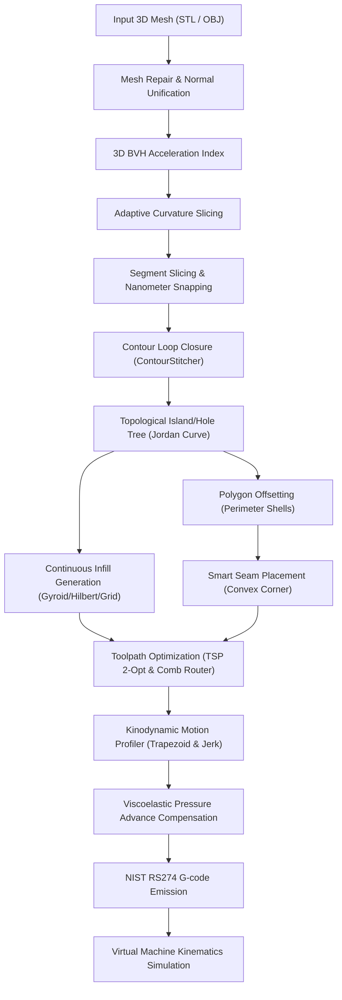

# Architecture Specification: Kerf

## 1. System Overview

Kerf is an autonomous 3D digital fabrication, mesh slicing, and kinodynamic motion planning engine written in LiveScript. Designed as a modular computational geometry pipeline, Kerf converts arbitrary 3D surface meshes (Wavefront OBJ, Binary/ASCII STL, procedural solid primitives) into validated machine toolpaths and optimized NIST RS274/NGC G-code.

Under the hood, Kerf pairs 64-bit floating-point spatial transforms with exact nanometer integer coordinate quantization. Triangle-plane cross sections are accelerated via a 3D Surface Area Heuristic (SAH) Bounding Volume Hierarchy (BVH), stitched into closed 2D loops via spatial endpoint snapping, and organized into topological nesting trees according to the Jordan curve theorem. Interior solids are buffered using polygon offsetting algorithms and filled with continuous infill patterns, including 3D Triply Periodic Minimal Surface (TPMS) gyroids and Hilbert space-filling curves. Rapid travel moves are routed through interior obstacle-avoidance corridors and ordered using Euclidean Traveling Salesperson (TSP) 2-opt search. Finally, all moves pass through a forward-backward lookahead acceleration profiler and viscoelastic pressure advance compensator before emission to disk.

```
       +-------------------------------------------------------------+
       |                     3D Surface Mesh                         |
       |             (Binary STL / Wavefront OBJ)                    |
       +-------------------------------------------------------------+
                                      |
                                      v
       +-------------------------------------------------------------+
       |                 Mesh Manifold Repair Kernel                 |
       |      (Deduplication, Vertex Welding, Normal Reorientation)  |
       +-------------------------------------------------------------+
                                      |
                                      v
       +-------------------------------------------------------------+
       |               3D Bounding Volume Hierarchy                  |
       |                (Surface Area Heuristic SAH)                 |
       +-------------------------------------------------------------+
                                      |
                                      v
       +-------------------------------------------------------------+
       |                 Adaptive Curvature Slicer                   |
       |          (Triangle-Plane Cross Section at Z planes)         |
       +-------------------------------------------------------------+
                                      |
                                      v
       +-------------------------------------------------------------+
       |                 Nanometer Contour Stitcher                  |
       |           (Graph Endpoint Closure & Loop Assembly)          |
       +-------------------------------------------------------------+
                                      |
                                      v
       +-------------------------------------------------------------+
       |                 Topological Hierarchy Tree                  |
       |          (Jordan Curve Nesting: Islands and Holes)          |
       +-------------------------------------------------------------+
                                      |
                                      v
       +-------------------------------------------------------------+
       |                 2D Polygon Offsetting Engine                |
       |         (Concentric Perimeters, Insets, Smart Seams)        |
       +-------------------------------------------------------------+
                                      |
                                      v
       +-------------------------------------------------------------+
       |                 Continuous Infill Generator                 |
       |         (3D Gyroid TPMS, Hilbert, Honeycomb, Grid)          |
       +-------------------------------------------------------------+
                                      |
                                      v
       +-------------------------------------------------------------+
       |                 Toolpath TSP & Comb Router                  |
       |          (2-Opt Travel Search, Perimeter Avoidance)         |
       +-------------------------------------------------------------+
                                      |
                                      v
       +-------------------------------------------------------------+
       |              Kinodynamics & Acceleration Profiler           |
       |       (Junction Deviation, Forward-Backward Lookahead)      |
       +-------------------------------------------------------------+
                                      |
                                      v
       +-------------------------------------------------------------+
       |                  G-code Emitter & Simulator                 |
       |          (Multi-Flavor RS274 Output & VM Kinematics)        |
       +-------------------------------------------------------------+
```



---

## 2. Subsystem Breakdown

### 2.1 Core Math & Precision Quantization (`src/math/`)
Floating-point arithmetic is inherently subject to IEEE 754 precision artifacts. Small rounding differences can cause degenerate line segments or self-intersecting polygons when offsetting contours. Kerf resolves this by adopting a dual-coordinate representation:
1. Continuous 3D transforms (`Vector3`, `Matrix4`, `Plane3D`, `Quaternion`) run on 64-bit IEEE floats for smooth rotations and translations.
2. Planar slicing and 2D polygon operations use fixed-point nanometer quantization (`Units.mm_to_nm` where 1 mm = 1,000,000 nm). Snapping vertices to nanometer integer coordinates guarantees topological stability and eliminates micro-gap degeneracy.

### 2.2 Mesh & Manifold Repair (`src/mesh/`)
The mesh subsystem parses binary and ASCII STL and Wavefront OBJ files. The manifold repair kernel repairs CAD export defects:
- Pruning degenerate zero-area triangles.
- Vertex welding: clusters vertices within spatial tolerance cells to close micro-gaps.
- Normal orientation: uses divergence theorem signed volume integration to detect inverted hulls and enforce uniform outward normals.
- Procedural primitives: built-in procedural generators for calibration cubes, mechanical gears, cylinders, and spheres.

### 2.3 Spatial Acceleration (`src/spatial/`)
Mesh slicing queries evaluate whether a horizontal plane Z intersects any of the mesh triangles. A naive linear scan requires O(N) operations per layer. Kerf builds a 3D Bounding Volume Hierarchy (BVH) using the Surface Area Heuristic (SAH) and midpoint spatial splitting. Layer slicing queries execute in O(log N + K) time, where K is the number of intersecting triangles. A spatial hash grid provides O(1) amortized nearest-neighbor queries during contour stitching.

### 2.4 Slicing & Topological Hierarchy (`src/slicing/`)
At each elevation Z, triangle-plane intersections yield oriented line segments. The `ContourStitcher` links segment endpoints into closed polygons. Next, the `TopologyTree` evaluates mutual containment using the Jordan curve theorem:
- Contours with an even number of parents are solid outer islands.
- Contours with an odd number of parents are hollow interior voids (holes).
- Nested islands inside holes (e.g. concentric pipes) are recursively attached as children.
The `AdaptiveSlicer` analyzes local surface normal tilt to vary layer thickness dynamically between Z_min (0.08 mm) and Z_max (0.28 mm), minimizing staircase error while maximizing throughput.

### 2.5 2D Computational Geometry & Offsetting (`src/geometry2d/`)
The `PolygonOffset` engine performs straight-skeleton and parallel edge buffering with Miter, Bevel, and Round corner transitions. Inset offsets generate concentric inner walls, while outset offsets generate brim and raft adhesion layers. `PolygonClipper` implements Sutherland-Hodgman clipping to trim toolpath vectors to arbitrary polygon boundaries.

### 2.6 Infill Generation (`src/infill/`)
Kerf implements six infill pattern generators:
- Rectilinear Infill: Alternating parallel scanlines (e.g. 45 and 135 degrees) with monotonic turnaround chaining.
- Grid Infill: Orthogonal two-pass crosshatching for compressive loading.
- Concentric Infill: Recursive inward offsetting following component boundaries.
- Honeycomb Infill: Hexagonal cell arrays with continuous edge chaining.
- Hilbert Infill: Recursive fractal space-filling curves for uniform in-plane mechanical properties.
- 3D Gyroid Infill: Triply periodic minimal surface isolines extracted via 2D Marching Squares.
- Support Generator: Overhang angle detection with sacrificial breakaway interfaces.

### 2.7 Toolpath Optimization (`src/toolpath/`)
To minimize print time and surface defects:
- Smart Seam Placement: Identifies the sharpest exterior convex corner and places the layer start/stop retraction point there, optically concealing cosmetic seam lines.
- TSP 2-Opt Travel Optimizer: Models disconnected loops as a Traveling Salesperson Problem, using greedy nearest-neighbor initialization followed by iterative 2-opt edge-swap local search.
- Comb Router: Constrains rapid non-extrusion travel moves within previously printed island cores, preventing nozzle stringing across exterior visual faces.

### 2.8 Kinodynamics & Motion Planning (`src/motion/`)
Modern CNC controllers and 3D printers are limited by physical stepper motor inertia and frame resonance:
- Junction Deviation: Evaluates the centrifugal acceleration across corner transitions, reducing entry speed proportionally to turn sharpness.
- Trapezoidal Motion Planner: A two-pass forward and backward lookahead profiler that computes acceleration, cruise, and deceleration phases for every motion block.
- 7-Segment S-Curve Profiler: Limits jerk (derivative of acceleration) to eliminate mechanical vibration and ghosting.
- Pressure Advance: Models hotend viscoelastic nozzle melt dynamics, compensating for pressure hysteresis during speed changes.

### 2.9 G-code Generation & Virtual Machine (`src/gcode/`)
The G-code emitter outputs clean, NIST RS274/NGC compliant commands for Marlin, Klipper, RepRap, and LinuxCNC controllers. The built-in G-code interpreter simulates machine kinematics, tracks nozzle coordinates, computes filament consumption in meters and grams, and estimates total build time with sub-second accuracy.

### 2.10 Visual Inspection (`src/vis/`)
Kerf provides two visualization pipelines:
1. ANSI 256-color terminal renderer: Draws high-contrast slice previews directly in the console, color-coding outer perimeters (cyan), holes (magenta), and infill cores (amber).
2. SVG vector exporter: Generates scalable vector graphics of any slice layer, highlighting toolpath categories with custom styling.
